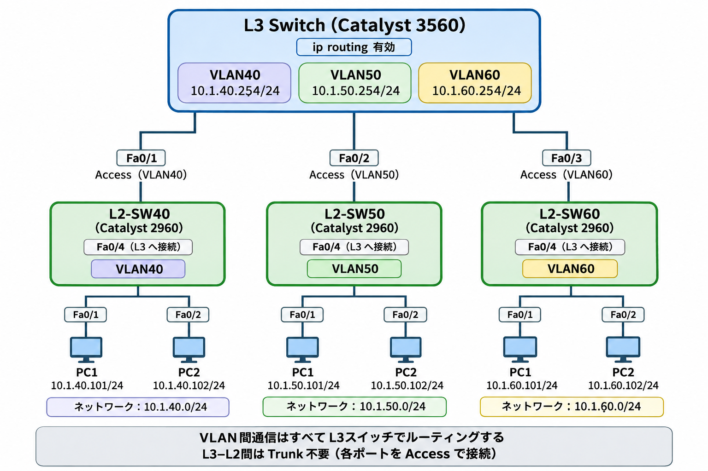

# Simple L3-L2 Structure

# 構成
## 使用するデバイス
- NetworkDevices > Switches > 3560-24PS
- NetworkDevices > Switches > 2960
- End Devices > End Devices > Laptop
## 構成図

# L3-SWの設定
## VLAN作成
~~~ sh
enable
configure terminal

vlan 40
 name VLAN40
 exit

vlan 50
 name VLAN50
 exit

vlan 60
 name VLAN60
 exit
~~~

## SVI設定
~~~ sh
enable
configure terminal

interface vlan 40
 ip address 10.1.40.254 255.255.255.0
 no shutdown
exit

interface vlan 50
 ip address 10.1.50.254 255.255.255.0
 no shutdown
exit

interface vlan 60
 ip address 10.1.60.254 255.255.255.0
 no shutdown
exit
~~~

## VLAN間ルーティング有効化
~~~ sh
enable
configure terminal

ip routing
~~~

## L2-SW40への接続
~~~ sh
enable
configure terminal

interface fastEthernet 0/1
 description TO_L2_SW40 # 50,60も同様
 switchport mode access
 switchport access vlan 40
 no shutdown
exit
~~~

## 確認
~~~ sh
enable
show vlan brief
show ip interface brief
show ip route
~~~

### 終了時
~~~ sh
end
write memory
~~~

---

# L2-SWの設定
## L2-SW40のVLAN作成
~~~ sh
enable
configure terminal

vlan 40
 name VLAN40
exit
~~~

## L3-SWへの接続
fastEthernet 0/1とL3を接続する場合
~~~ sh
enable
configure terminal

interface fastEthernet 0/1
 description TO_L3_SW
 switchport mode access
 switchport access vlan 40
 no shutdown
exit
~~~

## PCへの接続
fastEthernet 0/2～4にPC-L2を接続する場合
~~~ sh
enable
configure terminal

interface range fastEthernet 0/2 - 4
 switchport mode access
 switchport access vlan 40
 spanning-tree portfast
 no shutdown
exit
~~~

## 確認
~~~ sh
enable
show vlan brief
show interfaces status
show mac address-table
~~~
