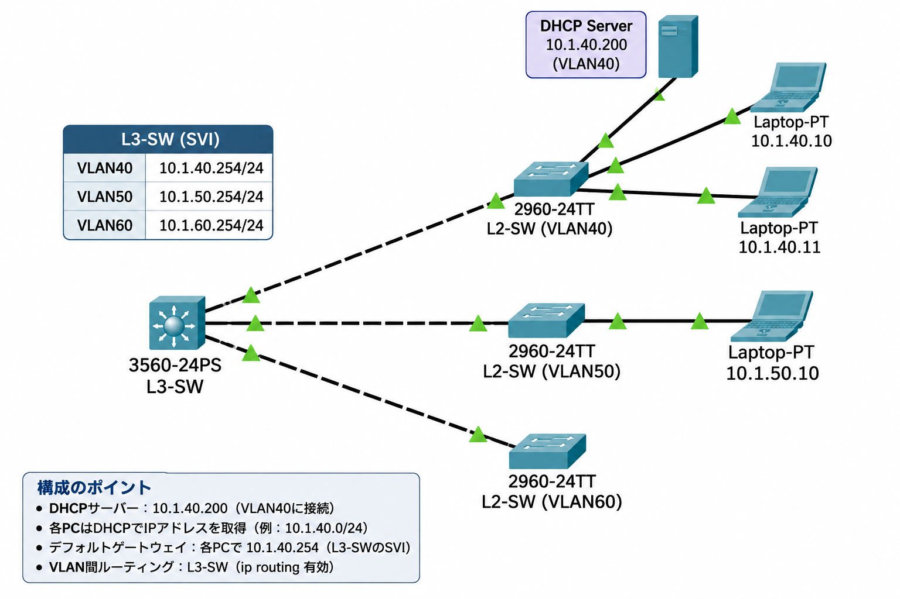

# Add DHCP server Simple L3-L2 Structure

# 構成
## 使用するデバイス
- NetworkDevices > Switches > 3560-24PS
- NetworkDevices > Switches > 2960
- End Devices > End Devices > Laptop
- End Devices > End Devices > Server

## 構成図

# L2,L3-SWの構成
[L3_setting.md](./L3_setting.md)参照のこと

# DHCPの設定
## サーバーの設置とIP設定
- End Devices > End Devices > Server

サーバーを配置後、固定IP設定
~~~
IP: 10.1.40.200/24
DefaultGW: 10.1.40.254
~~~

## L2-SWに接続
VLAN40に接続, もしVLANを設定していない場合はL2側で以下実行
~~~ sh
enable
configure terminal
interface fastEthernet 0/3　# 接続するポート
 description DHCP_SERVER
 switchport mode access
 switchport access vlan 40
 spanning-tree portfast
 no shutdown
end
show interfaces status
write memory
~~~

## DHCPサービス設定
~~~ sh
Service > DHCP
DHCPサービスをOnにする
~~~

## IP払い出し範囲設定
### 注意
デフォルトのserver poolという設定は消せないので、名前はそのままでIP等を変更して利用すること。
### VLAN40
~~~ sh
PoolName             ： VLAN40
DefaultGateway       ： 10.1.40.254
DNSServer            ： 0.0.0.0
StartIPAddress       ： 10.1.40.100
SubnetMask           ： 255.255.255.0
MaximumNumberofUsers ： 100
~~~
### VLAN50
~~~ sh
PoolName             ： VLAN50
DefaultGateway       ： 10.1.50.254
DNSServer            ： 0.0.0.0
StartIPAddress       ： 10.1.50.100
SubnetMask           ： 255.255.255.0
MaximumNumberofUsers ： 100
~~~
### VLAN60
~~~ sh
PoolName             ： VLAN60
DefaultGateway       ： 10.1.60.254
DNSServer            ： 0.0.0.0
StartIPAddress       ： 10.1.60.100
SubnetMask           ： 255.255.255.0
MaximumNumberofUsers ： 100
~~~

# L3-SWの設定
## DHCPリレーを設定
~~~ sh
enable
configure terminal

interface vlan 50
 ip helper-address 10.1.40.200
exit

interface vlan 60
 ip helper-address 10.1.40.200
exit

end
write memory
~~~
