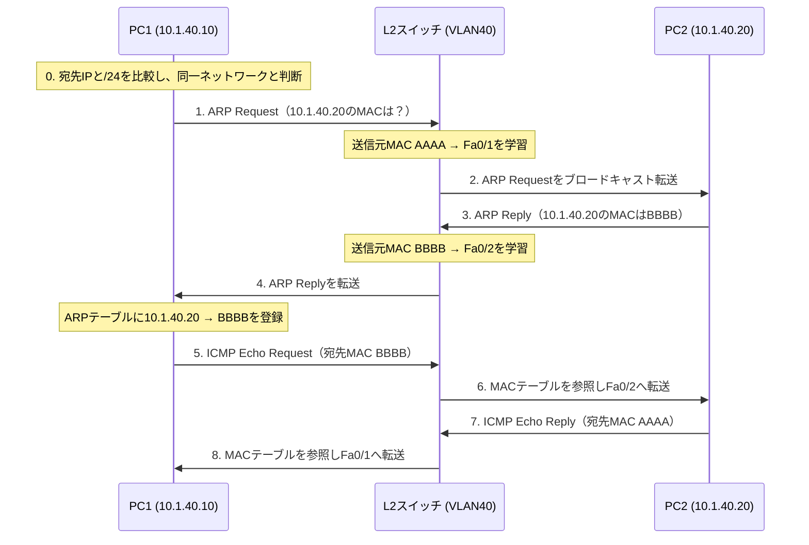

# PC間Ping通信のシーケンス（同一VLAN）

ネットワーク通信を、**誰が、何を受信し、何を判断し、次に何を送るか**という時系列で整理します。

## 前提構成

- PC1：`10.1.40.10/24`、MACアドレス `AAAA`
- PC2：`10.1.40.20/24`、MACアドレス `BBBB`
- 2台とも **VLAN40** に所属
- PC1の接続先：L2スイッチ `Fa0/1`
- PC2の接続先：L2スイッチ `Fa0/2`
- PCのARPテーブルと、L2スイッチの動的MACアドレステーブルは最初は空

```text
PC1（10.1.40.10 / MAC AAAA）
  │ Fa0/1
  │
L2スイッチ（VLAN40）
  │
  │ Fa0/2
PC2（10.1.40.20 / MAC BBBB）
```

## 通信シーケンス

PC1が `ping 10.1.40.20` を実行するケースです。



### 手順ごとの処理

| 順番 | 機器 | 処理 |
|---|---|---|
| 0 | PC1 | 宛先 `10.1.40.20` と自分のサブネット `/24` を比較し、同一ネットワークと判断する |
| 1 | PC1 | ARPテーブルに相手のMACがないため、ARP Requestをブロードキャスト送信する |
| 2 | L2スイッチ | 受信フレームの送信元MAC `AAAA` を `Fa0/1` に登録し、同じVLANの他ポートへ転送する |
| 3 | PC2 | 自分のIPに対するARP Requestなので、MAC `BBBB` をARP Replyで返す |
| 4 | L2スイッチ | 返信の送信元MAC `BBBB` を `Fa0/2` に登録し、PC1へ転送する |
| 5 | PC1 | `10.1.40.20 → BBBB` をARPテーブルに登録し、PingのICMP Echo Requestを送信する |
| 6 | L2スイッチ | 宛先MAC `BBBB` を見て `Fa0/2` へ転送する |
| 7 | PC2 | Pingを受信し、ICMP Echo ReplyをPC1へ送る |
| 8 | L2スイッチ | 宛先MAC `AAAA` を見て `Fa0/1` へ転送する |

> **補足：** 説明のため、チェックサムなど細部を省略しています。PC2もARP RequestからPC1のIPとMACを学習できるため、この例では返信前の追加ARPは不要です。

## IP・ARP・MACアドレステーブルの役割

| 仕組み | いつ使う？ | 何を判断・記録する？ |
|---|---|---|
| **IPアドレスとサブネットマスク** | 最初にPCが送信先を判断するとき | 同一ネットワークへ直接送るか、ゲートウェイへ送るか |
| **ARP** | 次に渡す相手のMACアドレスが不明なとき | IPアドレスに対応するMACアドレスを問い合わせる |
| **PCのARPテーブル** | フレーム送信の準備をするとき | IPアドレスとMACアドレスの対応 |
| **L2スイッチのMACアドレステーブル** | フレームを受信・転送するとき | MACアドレスと出力ポート（VLANごと）の対応 |

### 特に重要な違い

- **ARPテーブル：** `IPアドレス → MACアドレス`
- **MACアドレステーブル：** `MACアドレス → スイッチのポート`
- L2スイッチは、受信フレームの**送信元MACアドレス**から位置を学習し、**宛先MACアドレス**を使って転送先を決めます。

## Packet Tracerでの確認コマンド

L2スイッチ（2960）で確認します。

```cisco
show mac address-table
```

動的MACアドレスをクリアして通信前後の変化を観察する場合：

```cisco
clear mac address-table dynamic
show mac address-table
```

その後、PC1からPC2へPingを実行し、再度以下を確認します。

```cisco
show mac address-table
```

PC側ではARPテーブルも確認できます。

```powershell
arp -a
```

Packet Tracerの**Simulationモード**では、ARP Requestのブロードキャスト、ARP Reply、ICMP Echo Request / Replyを順番に追跡できます。

## まとめ

1. PCが**IPアドレスとサブネットマスク**から送信方法を判断する。
2. 必要なら**ARP**で宛先（または次の転送先）のMACアドレスを調べる。
3. PCが**宛先MACアドレス付きのEthernetフレーム**を送る。
4. L2スイッチが**送信元MACを学習**し、**宛先MACで転送**する。
5. PC2が受信し、同様の仕組みで返信する。

このシーケンスは**同一VLAN内**の通信です。VLAN40からVLAN50へ通信するときは、途中にL3スイッチのルーティング処理が入ります。
